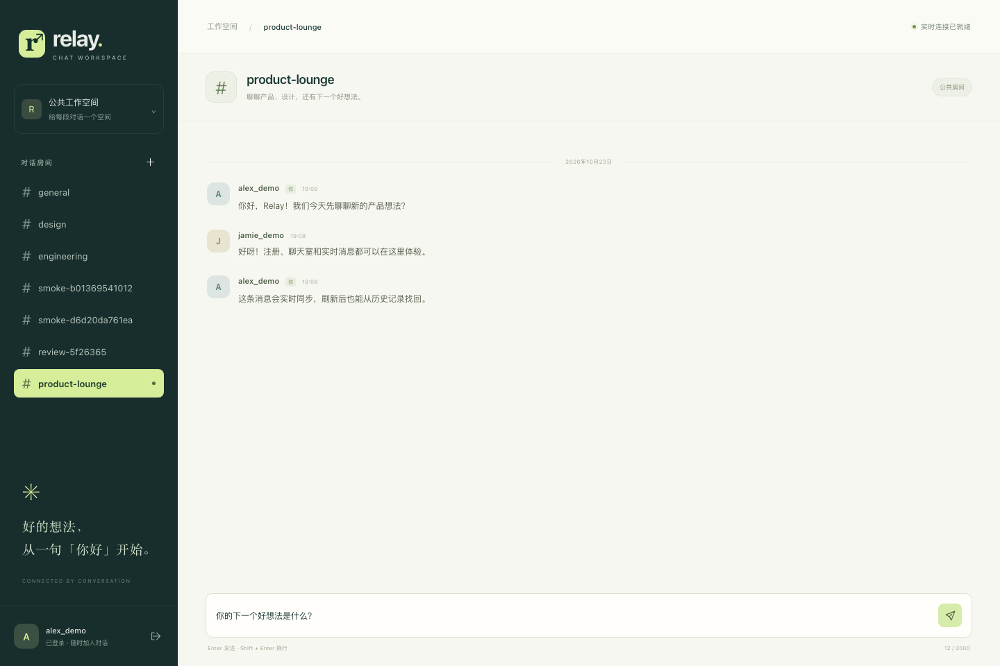

# Relay Chat

[](https://github.com/Cfengsu2002/relay-chat/actions/workflows/ci.yml)

[中文文档](README.zh-CN.md)

A real-time chat MVP with a responsive browser interface, authenticated APIs, persistent message history, and message delivery across multiple application instances.

**Stack:** Java 17 · Spring Boot · WebSocket · Redis · PostgreSQL · JWT · Docker



## Features

- Register and sign in with BCrypt password hashing and JWT authentication.
- Create public rooms, send messages, and load history with cursor-based pagination.
- Synchronize messages across application instances through Redis Pub/Sub.
- Use single-use WebSocket connection tickets and UUID-based message retries.
- Reconnect automatically and recover history through a responsive desktop and mobile UI.

## Run locally

### Java demo

Requires Java 17, OpenSSL, and Make. The Maven Wrapper downloads Maven and dependencies on the first run.

```bash
make demo
```

Open [localhost:8080](http://localhost:8080), register an account, and join a room. Use a second browser or private window to try two-user chat.

The demo uses an in-memory H2 database and local event delivery. Data is cleared on restart; this mode is for single-instance demonstrations.

### PostgreSQL and Redis

Requires Docker Engine, Docker Compose v2, and OpenSSL.

```bash
./scripts/init-env.sh
docker compose up --build -d --wait
```

The setup script creates an ignored `.env` file with random database and JWT secrets. Compose starts the application on port `8080` and keeps PostgreSQL and Redis on an internal network with persistent volumes.

```bash
curl --fail http://localhost:8080/actuator/health/readiness
docker compose down
```

`down` preserves stored messages. Adding `-v` deletes the database and Redis volumes.

## How messages flow

```text
REST API → PostgreSQL commit → Redis Pub/Sub → WebSocket clients on each instance
```

- Messages are published after the database transaction commits.
- A `(room_id, id DESC)` index supports history pagination without deep `OFFSET` scans.
- A `(sender_id, client_message_id)` unique constraint makes retries idempotent, including concurrent retries.
- WebSocket connections use a short-lived, single-use ticket instead of putting the JWT in the connection URL.

## Verification

The project includes **13 JUnit tests** covering authentication, history pagination, concurrent retries, transaction-aware publishing, and WebSocket ticket security.

```bash
./mvnw -B verify
```

GitHub Actions runs the JUnit suite, builds the Docker image, and checks HTTP/WebSocket communication between two application instances using real PostgreSQL and Redis.

To run the same integration check locally:

```bash
./scripts/init-env.sh
docker compose -f compose.yaml -f tests/compose.integration.yaml up -d --build --wait
python3 -m venv .venv
. .venv/bin/activate
python -m pip install -r tests/requirements.txt
CHAT_BASE_A=http://localhost:8080 CHAT_BASE_B=http://localhost:8081 python tests/e2e_smoke.py
```

With the application running and the virtual environment active, an optional Playwright check exercises two-user chat, refresh recovery, reconnection after 65 missed messages, pagination, text rendering, and mobile navigation:

```bash
python -m pip install -r tests/requirements-browser.txt
python -m playwright install chromium
CHAT_BROWSER_BASE=http://localhost:8080 python tests/browser_smoke.py
```

These checks create test accounts, rooms, and messages. Use a test database. Recorded results and desktop/mobile screenshots are in the [validation record](docs/VALIDATION.md).

## Documentation

- [API and WebSocket protocol](docs/API.md)
- [Deployment and configuration](docs/DEPLOYMENT.md)
- [Validation results](docs/VALIDATION.md)
- [Performance validation plan](docs/PERFORMANCE.md)
- [Full Chinese README](README.zh-CN.md)

## Scope and limitations

Rooms are public to all signed-in users. Private messaging, attachments, read receipts, and account recovery are outside this MVP.

Redis Pub/Sub does not retain missed events. PostgreSQL stores message history, but there is no transactional outbox: a failure between commit and publication can delay delivery until history is fetched.

The [Kubernetes manifests](deploy/k8s) provide examples for two application replicas, a Service, health probes, and an HPA. They have not been deployed to a real cluster as part of the recorded validation. The sample PostgreSQL and Redis services are single replicas.
