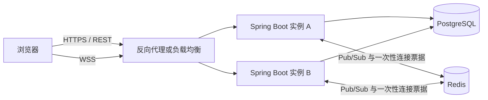
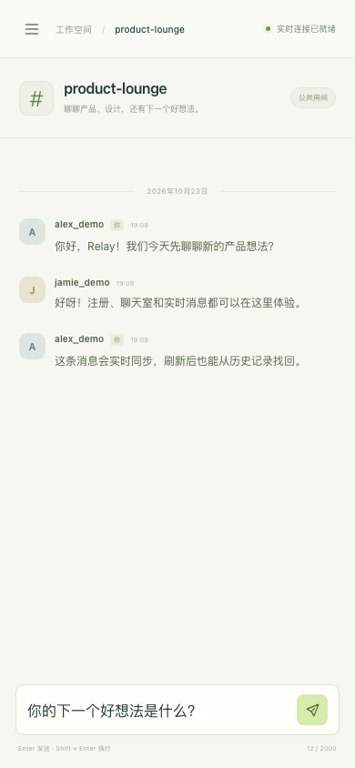

# Relay · 实时聊天室

[English](README.md)

[](https://github.com/Cfengsu2002/relay-chat/actions/workflows/ci.yml)

使用 Java 17、Spring Boot、原生 WebSocket、Redis Pub/Sub 和 PostgreSQL 的可运行聊天 MVP。内置同源网页界面、JWT 登录、公开房间、历史消息和断线重连，可用 Docker Compose 一次启动。

## 快速体验

需要 Java 17 和 OpenSSL。首次运行 Maven Wrapper 会下载 Maven 和项目依赖。

```bash
make demo
```

打开 [http://localhost:8080](http://localhost:8080)，注册账号并进入房间。用另一个浏览器或隐身窗口注册第二个账号，即可验证双向即时消息。`demo` 使用内存 H2 和进程内事件广播，重启后数据清空，适合本机演示。`make demo` 默认每次生成随机 JWT 密钥，也可显式设置自己的 `JWT_SECRET`。

## 使用 PostgreSQL 和 Redis

需要 Docker Engine 与 Docker Compose v2。

```bash
./scripts/init-env.sh
docker compose up --build -d
docker compose logs -f app
```

在 [http://localhost:8080](http://localhost:8080) 体验正式依赖下的运行模式。首次构建需下载镜像和依赖，应用就绪可用以下命令检查：

```bash
curl --fail http://localhost:8080/actuator/health/readiness
```

`init-env.sh` 会生成权限为 `600` 的 `.env`，包含随机数据库密码和 JWT 密钥，已有文件不会覆盖。`.env.example` 只说明配置格式。Compose 仅将应用端口映射到宿主机，数据库和 Redis 位于内部网络，并各自使用持久卷。

```bash
docker compose down
```

上述命令保留数据库。`docker compose down -v` 会删除持久卷和所有聊天数据，请只在确定需要清空时执行。修改 `.env` 的数据库密码不会自动修改已有数据库卷中的密码。

## 已实现的范围

- 注册、登录、BCrypt 密码存储、JWT 鉴权。
- 公开房间列表与创建，消息写入 PostgreSQL，按游标分页读取历史记录。
- 先持久化再广播，通过 Redis Pub/Sub 将新消息同步到各应用实例。
- WebSocket 使用短期、一次性的连接票据，避免将长期 JWT 放入连接 URL。
- 客户端消息 UUID 支持幂等重试；浏览器断线后重连并补读历史。
- 统一 API 响应、输入校验、健康检查、数据库迁移、容器和 Kubernetes 示例。

房间对所有已登录用户公开。MVP 不包含私聊、私有房间、邀请、附件、消息编辑/删除、搜索、已读回执、账户找回、审核后台或生产级防滥用系统。

## 架构



同一 WebSocket 连接始终由建立连接的实例处理，无需会话粘滞。新消息通过 Redis 广播到其他实例。Redis Pub/Sub 不保留离线事件，数据库是消息历史的来源；网络中断或广播失败时客户端应重新拉取历史。本 MVP 没有实现事务 outbox，数据库提交与广播之间存在故障窗口，不能保证每条消息即时送达。

消息历史使用 `(room_id, id DESC)` 索引与 ID 游标分页，避免随页码增加的 `OFFSET` 扫描；`(sender_id, client_message_id)` 唯一约束用于处理重复发送。这是实现机制，实际查询提速需用相同数据集与基线测量。

## 配置与开发

| 环境变量 | 用途 |
| --- | --- |
| `JWT_SECRET` | 必填；至少 32 个字符，所有应用实例必须相同 |
| `SPRING_DATASOURCE_URL` | PostgreSQL JDBC URL |
| `SPRING_DATASOURCE_USERNAME` | 数据库账号 |
| `SPRING_DATASOURCE_PASSWORD` | 数据库密码 |
| `SPRING_DATA_REDIS_HOST` / `SPRING_DATA_REDIS_PORT` | Redis 地址和端口 |
| `APP_PORT` | Compose 映射的宿主机端口，默认 `8080` |

直接运行 Java 时可用标准 Spring 环境变量，也支持配置文件中的 `DATABASE_URL`、`DATABASE_USERNAME`、`DATABASE_PASSWORD`、`REDIS_HOST`、`REDIS_PORT` 别名。直接运行服务时需要自行提供可访问的 PostgreSQL 与 Redis。

```bash
./mvnw -B verify
./mvnw -B package
```

测试使用隔离的测试配置。要验证真实 PostgreSQL、Redis 与双实例消息同步，可运行：

```bash
./scripts/init-env.sh
docker compose -f compose.yaml -f tests/compose.integration.yaml up -d --build --wait
python3 -m venv .venv
. .venv/bin/activate
python -m pip install -r tests/requirements.txt
CHAT_BASE_A=http://localhost:8080 CHAT_BASE_B=http://localhost:8081 python tests/e2e_smoke.py
docker compose -f compose.yaml -f tests/compose.integration.yaml down
```

另提供可选的真实浏览器验收，需先启动应用。使用虚拟环境安装 Playwright 和 Chromium：

```bash
python3 -m venv .venv
. .venv/bin/activate
python -m pip install -r tests/requirements-browser.txt
python -m playwright install chromium
CHAT_BROWSER_BASE=http://localhost:8080 python tests/browser_smoke.py
```

浏览器测试覆盖双用户聊天、刷新恢复、断线后的历史分页、文本安全与移动端导航。测试会创建独立测试账号、房间和消息，浏览器截图默认保存到被 Git 忽略的 `.local/browser-smoke/`。

2026-10-23 已在本机完成 13 项 JUnit 测试、真实 PostgreSQL/Redis 双实例端到端测试和 Chromium 桌面/手机尺寸验收，结果见 [验收记录](docs/VALIDATION.md)。GitHub Actions 会运行 `./mvnw -B verify`、构建 Docker 镜像，再启动真实依赖与两个应用实例执行 HTTP/WebSocket 端到端测试。

完整接口、WebSocket 协议及示例见 [API 文档](docs/API.md)，部署步骤见 [部署文档](docs/DEPLOYMENT.md)，性能复现方法见 [性能验证](docs/PERFORMANCE.md)。

## 生产部署边界

`deploy/k8s` 提供 2 个应用副本、Service、CPU HPA、探针和单副本 PostgreSQL/Redis 的示例。HPA 依赖集群 Metrics Server，扩容只影响新建连接；CPU 指标不足以全面反映长连接负载。示例数据库与 Redis 均不具备高可用性，需要按实际要求接入备份、故障转移与监控。

对外部署须配置域名与 HTTPS/WSS、入口超时、密钥管理、访问限流以及数据库备份。应用副本重启会断开相应连接，浏览器会尝试重连。详细操作和限制见 [部署文档](docs/DEPLOYMENT.md)。

## 界面预览

以下为本机实际运行的浏览器截图，使用专门创建的测试账号与示例消息。


<details>
<summary>查看手机端截图（390 × 844）</summary>



</details>
