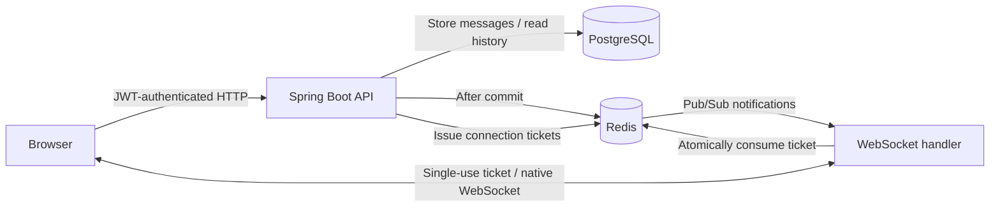

# Architecture

## Storage and ordering

Flyway creates the users, public rooms, and messages tables. Each message has a server ID and a client-generated UUID. A unique constraint on sender and client UUID makes retries idempotent. Reusing that UUID for different content or a different room returns a conflict.

Message creation locks the room row until the transaction commits. This keeps increasing message IDs aligned with commit order within a room, so an `after` cursor cannot skip a lower ID that is still being written. The `(room_id, id)` index supports history pagination.

## Live delivery

Fresh messages publish a notification only after the database transaction commits. In the normal configuration, Redis Pub/Sub distributes it to each application instance, which sends it to local sockets subscribed to that room. The demo profile uses a local message bus and an in-memory H2 database.

Redis notifications are transient. A failed live notification does not undo a saved message. The browser deduplicates by server ID and recovers history through HTTP after subscribing or reconnecting, and periodically while visible. Its recovery cursor advances only through HTTP results; receiving a newer live message does not skip intervening stored messages.

## Connection security

HTTP APIs authenticate with a Bearer JWT. The browser exchanges it for a random 30-second connection ticket and uses that ticket in the WebSocket handshake. Tickets expire no later than the JWT and can be consumed once. Redis consumption is atomic across instances; the demo uses a process-local store.

The handshake checks an explicit Origin allowlist before consuming the ticket. Open connections close when the JWT expires. Outgoing frames use bounded session buffers, and closed sessions remove their scheduled expiry tasks.

## Browser state

The JWT is kept in session storage. Each room maintains a message map, history cursors, a draft, and at most one unconfirmed send. A network failure retains the same client UUID for a retry. Message content is inserted using `textContent`.

Switching rooms replaces the socket subscription. Requests check the current account and room before updating the visible conversation. Logout clears timers, the socket, drafts, and cached messages.

## Deployment

Compose runs PostgreSQL and Redis on an internal network, with one application instance by default and a second through the `scale` profile. Both instances use the same image, database, Redis server, and JWT secret. Database and Redis volumes are independent of application containers.

The Java image runs as a non-root user. Application liveness is separate from readiness, which includes database and Redis availability. The Kubernetes examples apply the same shared-service layout with two app replicas, persistent claims, resource limits, and a CPU-based HPA.
